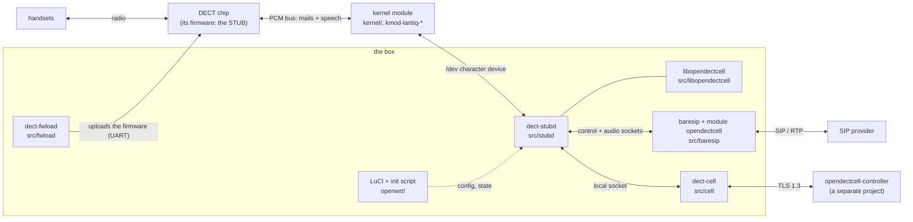

# Architecture

A map of openDECTcell for someone who is about to read or change the code. It says what the pieces are, how they
talk to each other, where each lives in the repository and which rules keep them apart. Detail is one link
away; unknown words are in the [glossary](docs/glossary.md).

## The idea in one paragraph

A FRITZ!Box's DECT chip does only the radio work: timing, the air interface, the lowest protocol layer. Everything
above it (the link layer, registration, authentication, ciphering, call control, the codec) used to run on the
router's CPU, inside the vendor's closed software. openDECTcell is a free replacement for that part. The chip runs
firmware that the user takes from their own FRITZ!OS image; our software uploads it, talks to it over the router's
PCM bus, runs the DECT protocol stack, and connects calls to SIP.

## The pieces and how they talk

| Piece | Job | Directory |
|---|---|---|
| **DECT chip + STUB** | Radio, DECT MAC layer, a mail interface to the host. Its firmware is never in this repository. | not ours |
| **Kernel module** | Moves bytes between the chip's bus and a character device: the mails and the speech. One transport per SoC family. | [kernel/](kernel/README.md); the 7412's and 7362 SL's transports are in their own repositories and are built into the packages |
| **dect-fwload** | Puts the user's chip firmware into the chip at every start. | [src/fwload/](src/fwload/README.md) |
| **dect-stubd** | The daemon that runs the base: finds the control channel, pumps mails, hosts the library, serves the bridge sockets, handles the registration window, parks the radio on stop, writes the state files. | [src/stubd/](src/stubd/README.md) |
| **libopendectcell** | The DECT protocol stack from the chip's mails up to calls, handset records, lists and the G.722 codec. **Hardware-free**: it is handed bytes and callbacks and knows nothing of devices or sockets. | [src/libopendectcell/](src/libopendectcell/README.md) |
| **baresip + module openDECTcell** | SIP, RTP and the network codecs; the module turns the daemon's call events into baresip calls and back, and moves audio. | [src/baresip/](src/baresip/README.md) |
| **dect-cell** | The box as a *cell* of a controller: a TLS link, enrolment, a relay of frames and audio to the controller. | [src/cell/](src/cell/README.md) |
| **LuCI app, init script, packages** | The web pages, the service script that reads the board profile and builds the daemon's command line, the OpenWrt feed. | [openwrt/](openwrt/README.md) |
| **Board profiles, handset profiles** | Per-model data: what a box needs, what a handset wants. Data, not code. | [boards/](boards/README.md), [profiles/](profiles/README.md) |

## Two ways to run

- **Standalone.** One box is the whole DECT system: `dect-stubd` with its own handsets, SIP through baresip,
  configured in LuCI. This is the original and simplest case.
- **As a cell.** The box does only the radio and the DECT stack's hardware side; the controller
  ([opendectcell-controller](https://github.com/openDECTcell/opendectcell-controller), separate repository) holds the handsets,
  the accounts and the SIP side for many boxes. Two things change on the box: `dect-stubd -K` hands the mails and
  the audio to `dect-cell`, and the library may also run **inside the controller** (it links the same
  `libopendectcell` through cgo), which is why the library must not depend on the box. See
  [hosting-dect-base.md](docs/hosting-dect-base.md) and [stack-in-library.md](docs/stack-in-library.md).

## How things flow

**Starting up.** The init script reads the board profile, loads the kernel module, runs `dect-fwload` (the chip
boots), then starts `dect-stubd`. The daemon probes for the control slot, sends the contact mail, learns the chip's
state, restores the handsets' records into the chip, and opens the radio.

**A handset registers.** A registration window opens (LuCI, or the controller). The handset sends its access-rights
request with the PIN; `dect_mm.c` runs the authentication (`dect_dsaa.c`), the record is saved, the key goes into a
chip slot, and the handset locates. Afterwards it re-locates on its own at an interval, and
the host answers each location registration.

**A call from a handset.** Radio → chip → a mail on the control slot → `dect_mail.c` decodes it → link and network
layers (`dect_link.c`, `dect_lapc.c`, `dect_nwk.c`) → call control (`dect_cc.c`, `dect_calls.c`) → a callback into the
host → the daemon sends `call-out` on the control socket → the baresip module places the SIP call. Speech runs
separately: the chip's voice slot on the bus, the daemon's audio socket, baresip's RTP. A call to a handset is the
same path in reverse, starting with a page.

**Stopping.** The service closes registration, switches the radio off, and reads back from the chip that it took
(*park*). If it did not, the init script holds the chip in reset. See [mac-bringup.md](docs/mac-bringup.md).

## Rules that keep the pieces apart

These are what a reviewer will check ([AGENTS.md](AGENTS.md) §1b and §5 have the full text):

1. **`libopendectcell` is hardware-free and model-free.** No device, socket or model name in it. It behaves the
   same on every box and inside the controller. A change to it changes every host, so its interface is versioned
   (`dect_proto.h`, [api-versions.md](docs/api-versions.md)) and replay-tested ([tests/](tests/README.md)).
2. **Model differences live in data.** A box's pins, device names and quirks are a board profile; the init script
   reads keys from it. A model's own kernel modules come in a package of their own, never as a dependency every
   box of the same SoC installs.
3. **A handset's quirks are a profile file**, not code branches on a model name.
4. **Wire formats are parsed field by field** with explicit endianness; a struct is never cast onto a buffer.
5. **No vendor code or firmware in the repository.** The chip's interface is documented in our own words from
   observation, with a label saying how each fact is known ([docs/README.md](docs/README.md#labels-used-in-the-documents)).
6. **The radio is switched off cleanly.** Every stop parks it and checks.

## Where to read next

| If you want to | Read |
|---|---|
| Build, test, change something | [docs/developing.md](docs/developing.md) |
| Find the file for a feature | the README of the directory (table above), then the file's header comment |
| Know what a word means | [docs/glossary.md](docs/glossary.md) |
| Understand the chip's interface | [docs/stub-api.md](docs/stub-api.md), [docs/stub-pcm-control-channel.md](docs/stub-pcm-control-channel.md) |
| See what works and what does not | [docs/status.md](docs/status.md) |
| Know how it got here | [docs/journals/](docs/journals/), the maintainers' notes, [ROADMAP.md](ROADMAP.md) |

## What is not in this repository

The chip firmware and calibration data (each user supplies their own); the controller and its web interface
(`opendectcell-controller`); the kernel transports for the 7412 and 7362 SL (their own repositories, built into the
packages); the vendor's software and anything analysed from it.
