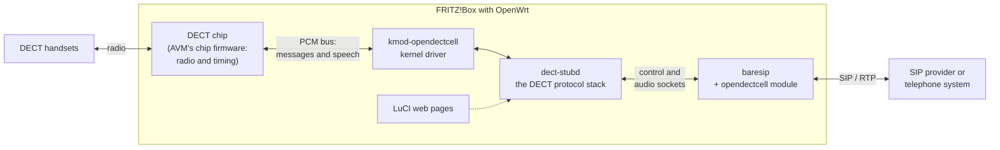

# openDECTcell

**An open-source DECT base station for FRITZ!Box routers running OpenWrt.**

[](https://github.com/openDECTcell/opendectcell/actions/workflows/packages.yml)
[](https://github.com/openDECTcell/opendectcell/releases)
[](LICENSE)

Many FRITZ!Boxes have a DECT base station built in, for cordless phones. Once
you install OpenWrt on such a box, that base station goes silent: its software
is part of AVM's closed firmware. openDECTcell brings it back, as free software.
Register your DECT handsets with the box, connect them to a SIP account, and
make phone calls, in HD voice and encrypted, configured in OpenWrt's web
interface.

> **Status: early, but it makes real phone calls.** On a FRITZ!Box 7520,
> Gigaset handsets register, ring, and call out and in over SIP. Many
> comfort features are still missing, and only one box model is tested. See [what works and what doesn't](docs/status.md).

## Features

- **Your handsets on OpenWrt:** register GAP and CAT-iq handsets with a
  random PIN; up to six per box.
- **Phone calls over SIP:** each handset gets up to two SIP accounts (*VoIP
  profiles*), for a provider or your own telephone system.
- **HD voice and encryption:** wideband G.722 audio, encrypted on the air by
  default.
- **Caller ID and line names** on the handset display.
- **Calls between handsets** on the same box.
- **A web interface for everything:** settings, handsets and VoIP profiles
  under Network > DECT; a live monitor (base, handsets, signal, SIP
  registrations, running calls, logs) under Status > DECT.
- **Signed packages** for OpenWrt, ready to upload in the web interface.

### What's missing so far

One SIP call at a time; no call waiting or hold; no phonebook on the handset;
a SIP account can ring only one handset; only the FRITZ!Box 7520 is tested.
The full list is in [docs/status.md](docs/status.md), and what comes next is
in the [roadmap](ROADMAP.md).

## Supported hardware

| Box | State |
|---|---|
| **FRITZ!Box 7520** | ✅ works: the development box |
| **FRITZ!Box 7530** | 🟡 same hardware as the 7520, not yet tested |
| FRITZ!Box 7412 | 🟡 base runs on a 7412 (needs `kmod-lantiq-ssc-pcm`); no handset registered yet |
| FRITZ!Box 7362 SL | analysed only |

**Tested handsets:** Gigaset A540 CAT, Gigaset C430A, Gigaset AS690H and AVM
FRITZ!Fon C4. openDECTcell follows the DECT standards, so other GAP or CAT-iq
handsets should work as well. Please [tell us](CONTRIBUTING.md) how yours
does.

## Quick start

You need a FRITZ!Box 7520 or 7530 running **OpenWrt 25.12.5**, a PC with
Python 3, and an official FRITZ!OS image for your box from AVM.

1. **Install the packages** from the [latest release](https://github.com/openDECTcell/opendectcell/releases):
   add the project's signing key once, then upload the packages under
   System > Software.
2. **Supply the DECT chip firmware.** openDECTcell cannot ship AVM's firmware for
   the DECT chip, so you extract it from the FRITZ!OS image on your PC:
   ```sh
   python3 tools/dect-fw-extract.py FRITZ.Box_7520-07.56.image
   ```
   The tool checks the files and prints the commands that copy them to the
   box.
3. **Switch it on:** Network > DECT, tick *Enable the DECT base*, *Save & Apply*.
4. **Register a handset:** tab *Handsets*, choose the handset's model if it
   is listed, press *Register a handset*, then start the registration on the
   handset and enter the PIN shown in the web page.
5. **Add a phone line:** tab *VoIP Profiles*, add your SIP account, then pick
   it as the handset's *Line 1*.

The step-by-step guide, including the command line: **[docs/install.md](docs/install.md)**.

## How it works



A FRITZ!Box's DECT chip (a Dialog SC144xx) only does the radio work. Its
firmware is uploaded by the router at every start, and everything above the
radio (registration, encryption, call setup) ran on the router CPU inside
AVM's closed kernel module. openDECTcell replaces that part:

- **`dect-fwload`** uploads the chip firmware you supplied.
- **`kmod-opendectcell`** is the kernel driver for the bus between the router and
  the chip, which carries both control messages and speech.
- **`dect-stubd`** and **`libopendectcell`** are the DECT protocol stack: link
  layer, registration and authentication, encryption, call control, and the
  G.722 codec, written from the ETSI standards (EN 300 175, EN 300 444,
  TS 102 527).
- **`opendectcell-baresip`** connects calls to SIP through
  [baresip](https://github.com/baresip/baresip).
- **`luci-app-opendectcell`** is the web interface.

More: [the documentation](docs/README.md).

## Building from source

The release packages are built by GitHub Actions with the official OpenWrt
SDK ([tools/release/build.sh](tools/release/build.sh)). To build them
yourself:

```sh
tools/release/build.sh ipq40xx/generic out   # FRITZ!Box 7520/7530
tools/release/build.sh lantiq/xrx200 out     # FRITZ!Box 7412
```

For development on a PC, `make check` builds the unit tests and runs them (no
hardware needed), and `make cross SDK=…` builds the programs for the
box. Details: [CONTRIBUTING.md](CONTRIBUTING.md).

## Clean room

openDECTcell is an independent implementation, written to interoperate with
hardware people already own.

- **No AVM code.** No AVM code, analysed code or AVM device-tree source is
  in this repository. The protocol stack is written from the public ETSI
  standards; the interface to the DECT chip is documented in our own words,
  from observation and interoperability analysis, and new code is written
  from those documents.
- **No AVM firmware.** The DECT chip firmware and the per-device calibration
  data are never shipped. Each user takes the firmware from AVM's own image
  for their own box; the documents refer to it only by SHA-256.
- **Legal basis:** EU Directive 2009/24/EC, Art. 5(3) and Art. 6
  (interoperability), in Germany §69d and §69e UrhG.
- **How the work is done:** the project is developed with AI coding agents
  under these rules; [AGENTS.md](AGENTS.md) holds them.

openDECTcell is not affiliated with or endorsed by AVM. FRITZ!Box and FRITZ!Fon are
trademarks of AVM GmbH; Gigaset is a trademark of Gigaset Communications GmbH.

## About this project

openDECTcell was created by [ctandi](https://github.com/ctandi), partly in free
time and partly at work, as a research project on **reverse engineering with
AI**: how far AI coding agents get with a real, undocumented hardware
interface when they work under strict clean-room rules. The project was made
possible by the technology magazine **c't / [heise](https://heise.de)**.

## Credits

openDECTcell contains no code from other projects, but it stands on a lot of
public work. These sources were read, compared against or used as tools:

- **[ETSI](https://www.etsi.org)** for the DECT standards (EN 300 175,
  EN 300 444 GAP, TS 102 527 CAT-iq), published free of charge, and the
  **ITU-T** for G.722.
- **OsmoDECT / Linux DECT** (the osmocom DECT project, Patrick McHardy and
  contributors), in particular `libdect` and the Linux `net/dect` stack, used
  as a cross-check for the protocol, and its SC1442x driver as posted in the
  [2014 OpenWrt DECT patch](https://lists.openwrt.org/pipermail/openwrt-devel/2014-June/000225.html)
  by Daniel Golle, and the
  [2017 follow-up](https://gist.github.com/koppi/43608dbb89f6b3880642108e62f43846),
  used for comparison with the newer chip generation.
- **Erik Tews**, "DECT Security Analysis" (thesis); S. Lucks, A. Schuler,
  E. Tews, R.-P. Weinmann and M. Wenzel, "Attacks on the DECT
  authentication mechanisms" (CT-RSA); and the
  **[deDECTed.org](https://dedected.org)** project, for the published DECT
  authentication algorithm (DSAA) and its test vectors.
- **AVM's published GPL source code** for FRITZ!OS
  ([osp.avm.de](https://osp.avm.de)), read for the router side of the DECT
  bus, and Qualcomm's code in it.
- **[Freetz-NG](https://github.com/Freetz-NG/freetz-ng)**, for observing the
  stock firmware on a box.
- **[OpenWrt](https://openwrt.org)** and **LuCI**, the platform, and the
  Linux kernel's Lantiq SSC driver for the 7412 analysis.
- **[baresip](https://github.com/baresip/baresip)**, the SIP stack the calls
  go through.
- **[FFmpeg](https://ffmpeg.org)**, as the independent reference our G.722
  codec was checked against.
- **Renesas / Dialog Semiconductor** for the public SC14441 product
  documentation.
- The **[IP Phone Forum](https://www.ip-phone-forum.de)** community, for
  FRITZ!Box hardware details, and **Eventphone**, for its DECT handset
  compatibility list.

## Contributing

Reports of handsets and boxes, bug reports and code are welcome:
[CONTRIBUTING.md](CONTRIBUTING.md).

## License

GPL-2.0, see [LICENSE](LICENSE). The kernel driver under `kernel/` is
GPL-2.0-only; everything else (programs, `libopendectcell`, tools) is
GPL-2.0-or-later.
