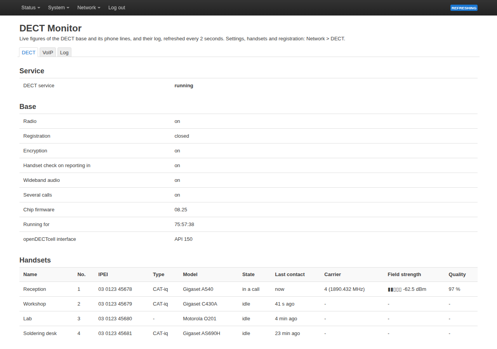
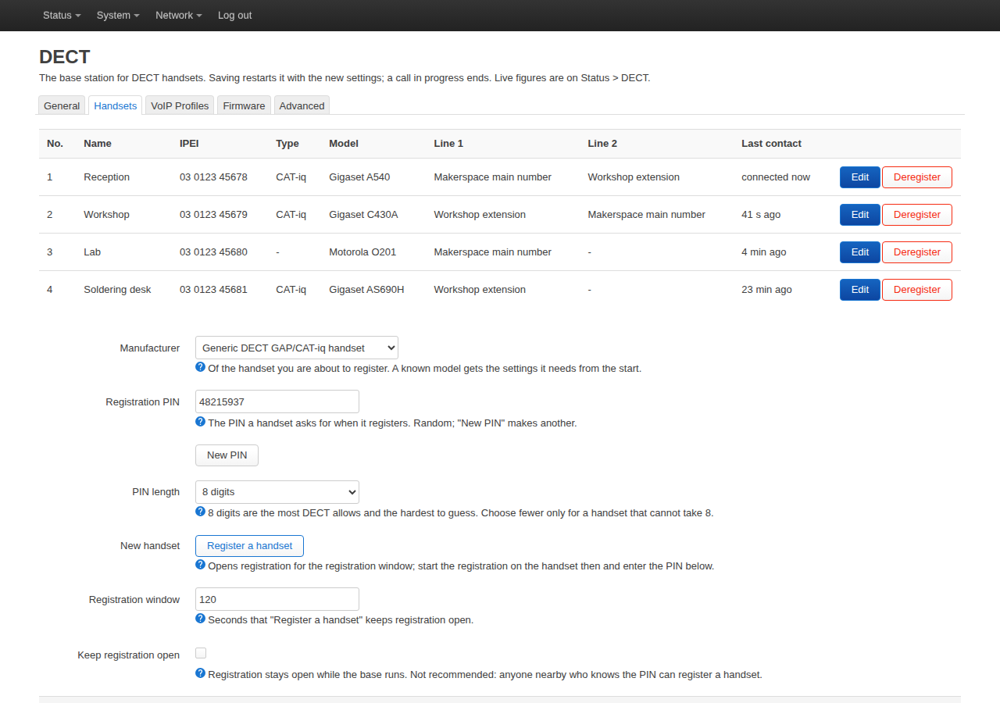
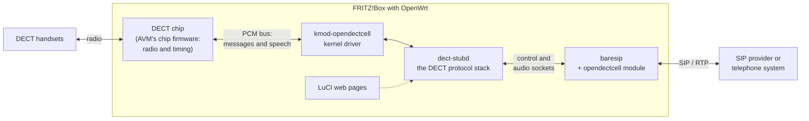

# openDECTcell

**An open-source DECT base station for FRITZ!Box routers running OpenWrt.**

[](https://github.com/openDECTcell/opendectcell/actions/workflows/packages.yml)
[](https://github.com/openDECTcell/opendectcell/releases)
[](LICENSES/GPL-2.0-or-later.txt)

Many FRITZ!Boxes have a DECT base station built in, for cordless phones. Once
you install OpenWrt on such a box, that base station goes silent: its software
is part of AVM's closed firmware. openDECTcell brings it back, as free software.
Register your DECT handsets with the box, connect them to a SIP account, and
make phone calls, in HD voice and encrypted, configured in OpenWrt's web
interface.

> **Status: early, but it makes real phone calls.** On a FRITZ!Box 7520 and a 7412,
> Gigaset handsets register, ring, and call out and in over SIP, alone or as cells of a
> controller. Some comfort features are still missing. See [what works and what doesn't](docs/status.md).

> **Please read: experimental software, about 99 % written by AI.** openDECTcell is provided as is, **without any warranty
> whatsoever**, and is not a finished product. Almost all of its code, tests and documentation were generated by AI coding
> agents; only smaller parts have been reviewed by a human. By using it you accept that it is purely experimental.
> **Do not rely on it for emergency calls (112, 110 or any other emergency number).** An openDECTcell base can fail, restart or
> lose its network at any time; keep a phone that does not depend on it. openDECTcell is non-commercial free software, written
> for interoperability with hardware people already own.

## Screenshots



*Status > DECT: the live monitor. Handsets with their state and field strength, and the radio link of a call in progress.*



*Network > DECT: the handsets of the box, their lines, and the registration of a new handset.*

More pages, with example entries, are in [docs/screenshots.md](docs/screenshots.md). Everything on them is made up.

## Features

- **Your handsets on OpenWrt:** register GAP and CAT-iq handsets with a
  random PIN; up to six per box, and many more with a [controller](#more-than-one-box-or-more-than-six-handsets-a-controller).
- **Phone calls over SIP:** each handset gets up to two SIP accounts (*VoIP
  profiles*), for a provider or your own telephone system; several handsets
  can share one, and a call to it rings them all.
- **Up to three calls at once**, over SIP or between handsets.
- **HD voice and encryption:** wideband G.722 audio, ciphered on the air with
  the DECT standard cipher when the handset supports it (DECT's cipher is weak).
- **Caller ID and line names** on the handset display.
- **Calls between handsets** on the same box (and, with a controller, between a user's handsets on different boxes).
- **A web interface for everything:** settings, handsets and VoIP profiles
  under Network > DECT; a live monitor (base, handsets, signal, SIP
  registrations, running calls, logs) under Status > DECT.
- **Signed packages** for OpenWrt, ready to upload in the web interface.

### What's missing so far

Call waiting, hold and a voicemail indicator are built but not yet tried on real handsets; the 7530 and the
7362 SL are not (fully) tested. The phonebook (from a CardDAV address book) and the call lists work on the
Gigaset A540. The full list is in [docs/status.md](docs/status.md), and what comes next is in the
[roadmap](ROADMAP.md).

## Supported hardware

| Box | State |
|---|---|
| **FRITZ!Box 7520** | ✅ works: the development box |
| **FRITZ!Box 7530** | 🟡 same hardware as the 7520, not yet tested |
| FRITZ!Box 7412 | 🟡 handsets register and calls work, standalone and as a cell (needs `kmod-lantiq-ssc-pcm`, which the releases include); in rare cases the box's network dies at a service stop ([details](docs/7412-stop-hang.md)) |
| FRITZ!Box 7362 SL | 🟡 works as a cell of a controller: SIP calls in and out in HD voice (needs `kmod-lantiq-usif-uart` and `kmod-lantiq-tdm-pcm`, which the releases include); as a standalone base not tested yet |

**Tested handsets:** Gigaset A540 CAT, Gigaset C430A, Gigaset AS690H, AVM
FRITZ!Fon C4 and, with its device profile, the Motorola O201. **Known problems:** the Siemens C45 and C450 register and
can dial out, but do not ring on incoming calls; the Motorola O201 goes on ringing for 10 to 15 seconds after the caller
hangs up ([docs/status.md](docs/status.md)). openDECTcell follows the DECT standards, so other GAP or CAT-iq
handsets should work as well. Please [tell us](CONTRIBUTING.md) how yours
does.

## Quick start

You need a FRITZ!Box 7520, 7530 or 7412, a PC with Python 3, and an official FRITZ!OS image for your box from AVM.
The kernel module fits only the OpenWrt release the packages were built for (the release page says which), so
either flash the release's **ready-made image** for your box (it has the packages inside) or install the packages
on exactly that OpenWrt release.

1. **Install the packages** from the [latest release](https://github.com/openDECTcell/opendectcell/releases):
   add the project's signing key once, then upload the packages under
   System > Software.
2. **Supply the DECT chip firmware.** openDECTcell cannot ship AVM's firmware for
   the DECT chip, so you extract it from the FRITZ!OS image on your PC:
   ```sh
   python3 tools/dect-fw-extract.py FRITZ.Box_7520-07.56.image
   ```
   The tool checks the files and prints the commands that copy them to the
   box.
3. **Switch it on:** Network > DECT, tick *Enable the DECT base*, *Save & Apply*.
4. **Register a handset:** tab *Handsets*, choose the handset's model if it
   is listed, press *Register a handset*, then start the registration on the
   handset and enter the PIN shown in the web page.
5. **Add a phone line:** tab *VoIP Profiles*, add your SIP account, then pick
   it as the handset's *Line 1*.

The step-by-step guide, including the command line: **[docs/install.md](docs/install.md)**.

### More than one box, or more than six handsets: a controller

A box can also be a **cell** of a [openDECTcell controller](https://github.com/openDECTcell/opendectcell-controller): a
server (Docker) that runs the DECT stack, the SIP accounts and a web interface for many boxes, so that handsets
**roam** between them and you can have many handsets. Install the `opendectcell-cell` package, enrol the box with a
one-time string from the controller (Network > DECT, *Make this box a cell…*), and register handsets at the
controller. The full guide, from the controller's Docker setup to the first call and from roaming to
troubleshooting, is the controller's wiki:
**[docs/wiki/Quick-start.md](https://github.com/openDECTcell/opendectcell-controller/blob/main/docs/wiki/Quick-start.md)**.

Multi-cell operation is early. What has been tried on real hardware, and what is only built or simulated (for
example calls between boxes, and handsets moving between cells on their own), is in
[docs/status.md](docs/status.md) and [docs/journals/bench-status-2026-11-02.md](docs/journals/bench-status-2026-11-02.md).

## How it works



A FRITZ!Box's DECT chip (a Dialog SC144xx) only does the radio work. Its
firmware is uploaded by the router at every start, and everything above the
radio (registration, encryption, call setup) ran on the router CPU inside
AVM's closed kernel module. openDECTcell replaces that part:

- **`dect-fwload`** uploads the chip firmware you supplied.
- **`kmod-opendectcell`** is the kernel driver for the bus between the router and
  the chip, which carries both control messages and speech.
- **`dect-stubd`** and **`libopendectcell`** are the DECT protocol stack: link
  layer, registration and authentication, encryption, call control, and the
  G.722 codec, written from the ETSI standards (EN 300 175, EN 300 444,
  TS 102 527).
- **`opendectcell-baresip`** connects calls to SIP through
  [baresip](https://github.com/baresip/baresip).
- **`luci-app-opendectcell`** is the web interface.

More: [the documentation](docs/README.md), and for cells and a controller
[the wiki](https://github.com/openDECTcell/opendectcell-controller/blob/main/docs/wiki/Home.md).

## Documentation and code map

| You want to | Start here |
|---|---|
| Use it | [docs/status.md](docs/status.md), [docs/install.md](docs/install.md), [docs/luci-manual.md](docs/luci-manual.md) |
| Understand how it is built | [ARCHITECTURE.md](ARCHITECTURE.md), [docs/glossary.md](docs/glossary.md) |
| Change the code | [docs/developing.md](docs/developing.md), [CONTRIBUTING.md](CONTRIBUTING.md), and the README in each source directory: [src/libopendectcell](src/libopendectcell/README.md), [src/stubd](src/stubd/README.md), [src/cell](src/cell/README.md), [src/fwload](src/fwload/README.md), [src/baresip](src/baresip/README.md), [kernel](kernel/README.md), [boards](boards/README.md), [profiles](profiles/README.md), [tests](tests/README.md), [openwrt](openwrt/README.md), [tools](tools/README.md) |
| Know the chip's interface | [docs/stub-api.md](docs/stub-api.md) and the other reference documents in [docs/README.md](docs/README.md) |
| See how it got here | [docs/journals/](docs/journals/README.md), [ROADMAP.md](ROADMAP.md) |

## Building from source

The release packages are built by GitHub Actions with the official OpenWrt
SDK ([tools/release/build.sh](tools/release/build.sh)). To build them
yourself:

```sh
tools/release/build.sh ipq40xx/generic out   # FRITZ!Box 7520/7530
tools/release/build.sh lantiq/xrx200 out     # FRITZ!Box 7412
```

For development on a PC, `make check` builds the unit tests and runs them (no
hardware needed), and `make cross SDK=…` builds the programs for the
box. Details: [CONTRIBUTING.md](CONTRIBUTING.md).

## Clean room

openDECTcell is an independent implementation, written to interoperate with
hardware people already own.

- **No AVM code.** No AVM code, analysed code or AVM device-tree source is
  in this repository. The protocol stack is written from the public ETSI
  standards; the interface to the DECT chip is documented in our own words,
  from observation and interoperability analysis, and new code is written
  from those documents.
- **No AVM firmware.** The DECT chip firmware and the per-device calibration
  data are never shipped. Each user takes the firmware from AVM's own image
  for their own box; the documents refer to it only by SHA-256.
- **Legal basis:** EU Directive 2009/24/EC, Art. 5(3) and Art. 6
  (interoperability), in Germany §69d and §69e UrhG.
- **How the work is done:** the project is developed with AI coding agents
  under these rules; [AGENTS.md](AGENTS.md) holds them.

See [docs/clean-room-process.md](docs/clean-room-process.md) for how the two sides work and what the `[CR A-nnnn]` citations mean.

## Trademarks and affiliation

openDECTcell is not affiliated with or endorsed by AVM GmbH, Gigaset Communications GmbH, Motorola, ETSI, the DECT Forum, the
OpenWrt project or the Software Freedom Conservancy. DECT is a trademark of ETSI; CAT-iq is a mark of the DECT Forum;
OpenWrt is a trademark of the Software Freedom Conservancy; FRITZ!, FRITZ!Box and FRITZ!Fon are trademarks of AVM GmbH;
Gigaset and Motorola are trademarks of their owners. They are named here only to say which hardware openDECTcell works with.

## About this project

openDECTcell was created by [ctandi](https://github.com/ctandi) as a project for
journalistic research on **AI, and on reverse engineering with AI**: how far AI
coding agents get with a real, undocumented hardware interface when they work
under strict clean-room rules. It is published under a free licence as part of that
work, and was made possible by the technology magazine **c't / [heise](https://heise.de)**.
The code was written almost entirely by AI agents under the maintainer's direction
(see the note at the top).

## Credits

openDECTcell contains no code from other projects, but it stands on a lot of
public work. These sources were read, compared against or used as tools:

- **[ETSI](https://www.etsi.org)** for the DECT standards (EN 300 175,
  EN 300 444 GAP, TS 102 527 CAT-iq), published free of charge, and the
  **ITU-T** for G.722.
- **OsmoDECT / Linux DECT** (the osmocom DECT project, Patrick McHardy and
  contributors), in particular `libdect` and the Linux `net/dect` stack, used
  as a cross-check for the protocol, and its SC1442x driver as posted in the
  [2014 OpenWrt DECT patch](https://lists.openwrt.org/pipermail/openwrt-devel/2014-June/000225.html)
  by Daniel Golle, and the
  [2017 follow-up](https://gist.github.com/koppi/43608dbb89f6b3880642108e62f43846),
  used for comparison with the newer chip generation.
- **Erik Tews**, "DECT Security Analysis" (thesis); S. Lucks, A. Schuler,
  E. Tews, R.-P. Weinmann and M. Wenzel, "Attacks on the DECT
  authentication mechanisms" (CT-RSA); and the
  **[deDECTed.org](https://dedected.org)** project, for the published DECT
  authentication algorithm (DSAA) and its test vectors.
- **AVM's published GPL source code** for FRITZ!OS
  ([osp.avm.de](https://osp.avm.de)), read for the router side of the DECT
  bus, and Qualcomm's code in it.
- **[Freetz-NG](https://github.com/Freetz-NG/freetz-ng)**, for observing the
  stock firmware on a box.
- **[OpenWrt](https://openwrt.org)** and **LuCI**, the platform, and the
  Linux kernel's Lantiq SSC driver for the 7412 analysis.
- **[baresip](https://github.com/baresip/baresip)**, the SIP stack the calls
  go through.
- **[FFmpeg](https://ffmpeg.org)**, as the independent reference our G.722
  codec was checked against.
- **Renesas / Dialog Semiconductor** for the public SC14441 product
  documentation.
- The **[IP Phone Forum](https://www.ip-phone-forum.de)** community, for
  FRITZ!Box hardware details, and **Eventphone**, for its DECT handset
  compatibility list.

## Contributing

Reports of handsets and boxes, bug reports and code are welcome:
[CONTRIBUTING.md](CONTRIBUTING.md); the working guide for code is [docs/developing.md](docs/developing.md).

## License

Copyright (C) 2026 the openDECTcell authors.

openDECTcell is **GPL-2.0-or-later**, except the kernel modules under `kernel/`, which are GPL-2.0-only (the texts are in [LICENSES/](LICENSES/), `LICENSE` is the GPL-2.0). The licence of each component is listed in [docs/licensing.md](docs/licensing.md), the third-party parts in [THIRD_PARTY.md](THIRD_PARTY.md); the policy for reporting a vulnerability is [SECURITY.md](SECURITY.md); what data the box keeps is in [docs/privacy-and-data.md](docs/privacy-and-data.md).
