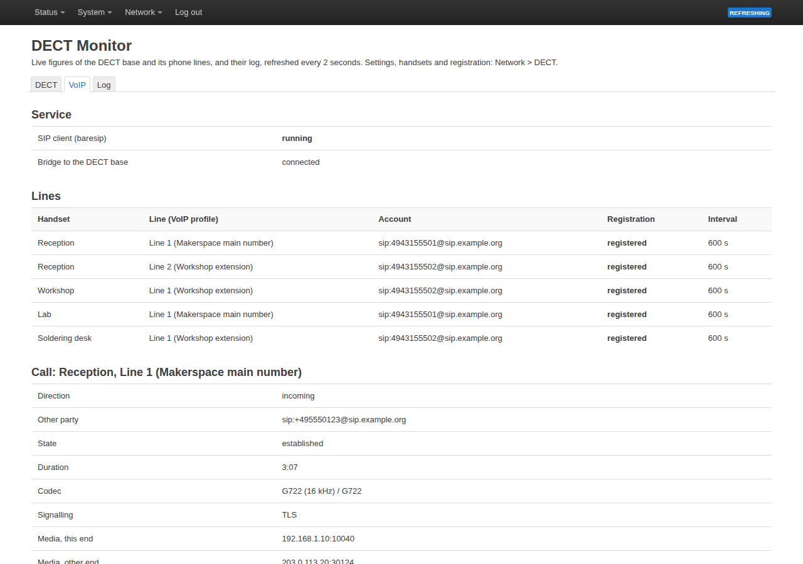
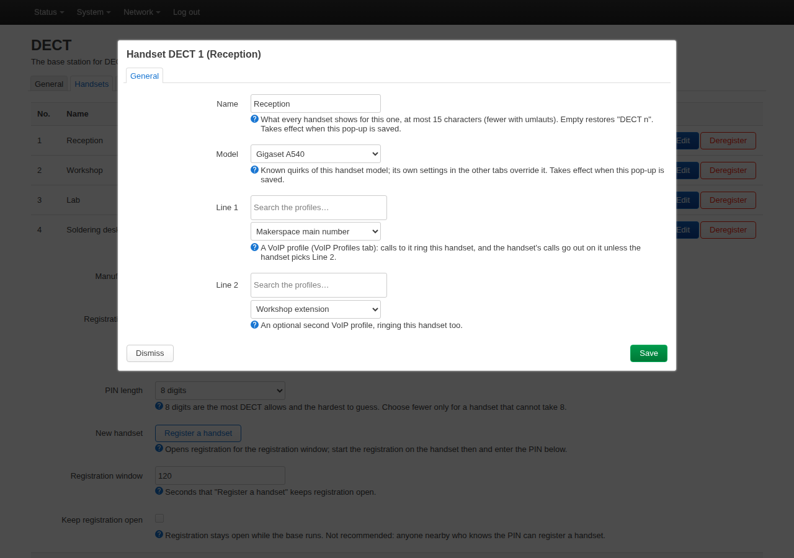
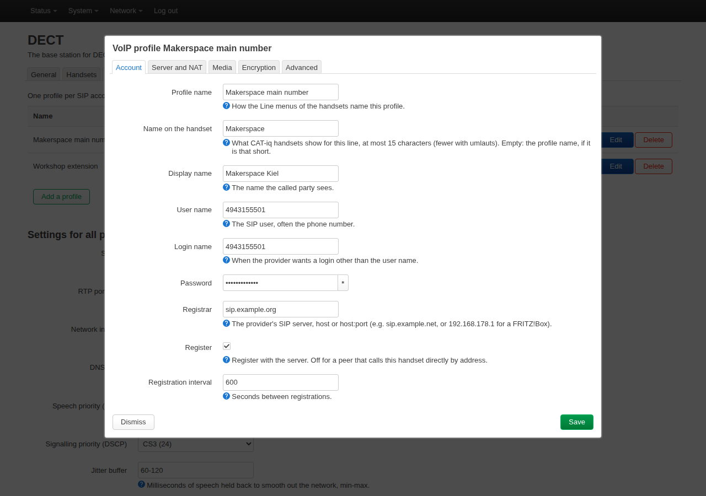
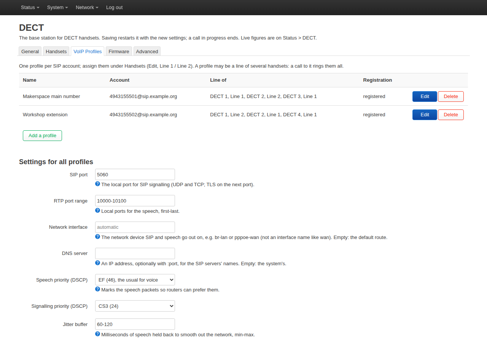

# Screenshots

The web pages of openDECTcell, with example entries. Everything on them is made up: the handsets, names, numbers and the SIP
provider (`sip.example.org`) belong to an imaginary makerspace, and the pages come from a test setup, not from a household.
They are pages of OpenWrt 25.12's web interface (LuCI) with the standard Bootstrap theme; openDECTcell adds two pages,
**Status > DECT** and **Network > DECT**. Field by field, the pages are explained in the [web pages manual](luci-manual.md).

## Status > DECT: the DECT Monitor

The DECT tab, shown in the [README](../README.md#screenshots), shows whether the service runs and how the base is set (radio, registration window, encryption, wideband
audio, chip firmware), then every handset with its model, state, last contact and, while it is in a call, the carrier,
the field strength and the radio quality. Below, a connection section lists the call in progress. The page refreshes
every two seconds.

The VoIP tab shows the SIP side: which handset line is registered with which account, and for a call in progress the
codec, whether signalling and speech are encrypted, both media endpoints, the data rate, lost packets and jitter.

## Network > DECT: settings

The Handsets tab, shown in the [README](../README.md#screenshots), lists the handsets registered with the box (up to six), the VoIP profiles each uses as Line 1 and
Line 2, and when each was last heard. Below the list a new handset is registered: pick the model, press *Register a
handset*, and enter the PIN shown on the page on the handset.

*Edit* opens a handset's dialog: the name every other handset shows for it, its model (a known model gets the settings
it needs), and which VoIP profiles are its lines.

A VoIP profile is one SIP account. The tab lists them, which handset lines use each, and whether they are registered;
below are the settings all profiles share (ports, priorities, jitter buffer, certificate checks).

A profile's dialog has tabs for the account, the server and NAT handling, media, encryption and advanced options.

The General tab holds the switches: the base on or off, encryption, handset checks, wideband audio, several calls at
once, and how dialled digits are collected.
